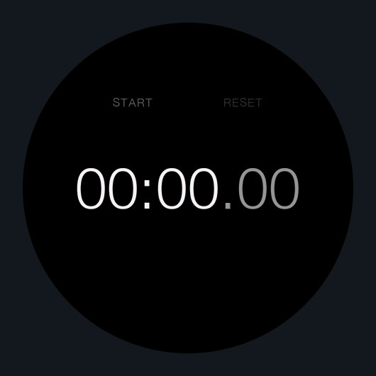
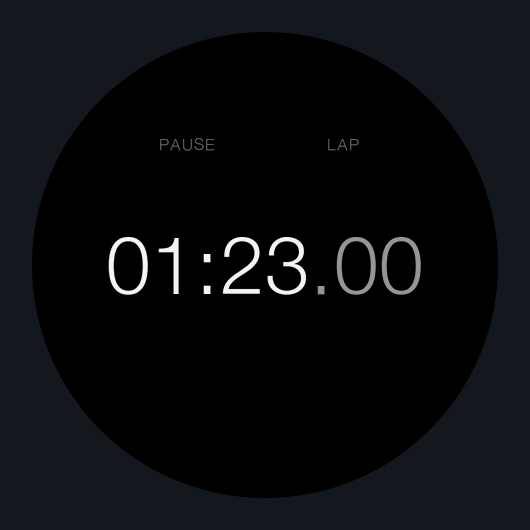
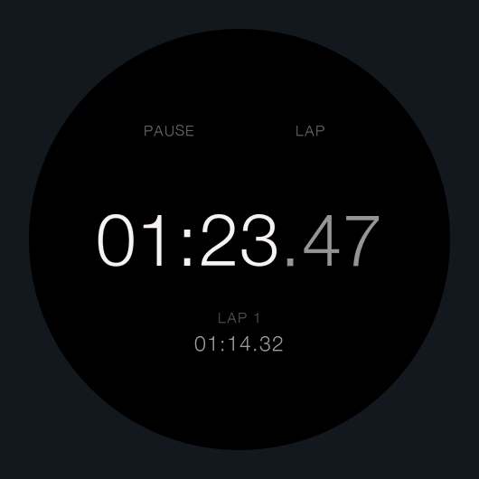
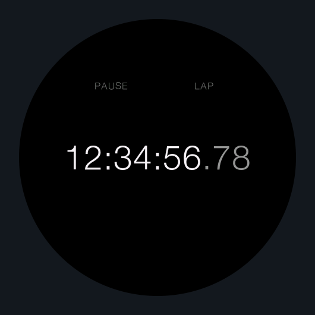
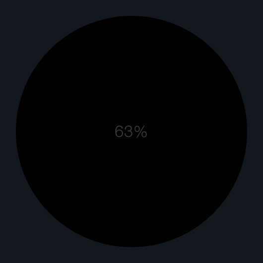

# Stopwatch

A two-button stopwatch for the round Waveshare ESP32-S3-Touch-AMOLED-1.75C, with lap timing, a hold-to-view battery percentage, and light sleep on battery power.

[Flash over USB](https://xn--sg8hhb.ws/flasher/?project=stopwatch) · [Latest firmware release](https://github.com/xberenguer/stopwatch/releases/latest) · [Get the device](https://www.waveshare.com/esp32-s3-touch-amoled-1.75c.htm)

<p align="center">
  <a href="previews/ready-charcoal.png" title="Ready"></a>
  <a href="previews/running-total.gif" title="Running"></a>
  <a href="previews/lap-charcoal.png" title="Lap"></a>
  <a href="previews/hours-charcoal.png" title="Hours"></a>
  <a href="previews/battery-charcoal.png" title="Battery"></a>
</p>

## Controls

Hold the device with both buttons on top.

| Tap | Running | Stopped | Asleep |
|---|---|---|---|
| Large, top left | Pause | Start or resume | Wake and start |
| Small, top right | Record lap | Reset | Wake to zero |

The first lap measures from the start. Later laps measure from the previous lap. The screen shows the most recent lap beneath the running total.

## Battery and sleep

Start with the stopwatch stopped at zero. Use one continuous hold on the small button.

- **At 0.6 seconds**, the screen goes dark. Release to sleep.
- **At 1.2 seconds total**, the battery percentage appears in grey at the center. Release to turn the display off again and sleep.

On battery power, the ESP32 enters light sleep after you release. When you turn off the screen on USB power, the USB flasher remains available.

## Build

Firmware needs the Espressif Xtensa Rust toolchain, an ESP32-S3 GCC linker, and esptool 4.9.0.

```sh
cargo +stable test --locked
python3 tools/build.py
```
