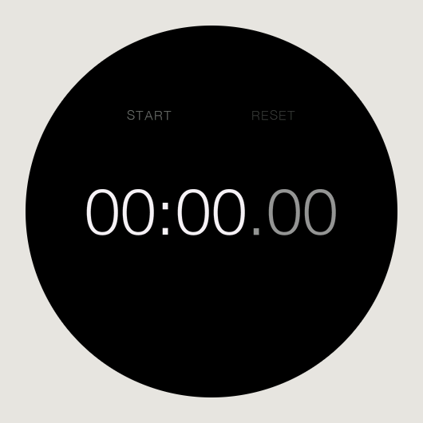

# Stopwatch

A minimal, button-only Rust stopwatch for the Waveshare ESP32-S3-Touch-AMOLED-1.75C.

[Flash over USB](https://xn--sg8hhb.ws/flasher/?project=stopwatch) · [Get the device](https://www.waveshare.com/esp32-s3-touch-amoled-1.75c.htm) · [Firmware](https://github.com/xberenguer/stopwatch/releases/latest)



Hold the device with both buttons on top.

| Button | Running | Paused |
|---|---|---|
| Large, top left | Pause | Start / resume |
| Small, top right | Lap | Reset |

The total stays centered. The latest lap appears below it.

## Build

Firmware needs the Espressif Xtensa Rust toolchain, an ESP32-S3 GCC linker, and esptool 4.9.0.

```sh
cargo +stable test --locked
python3 tools/build.py
```
